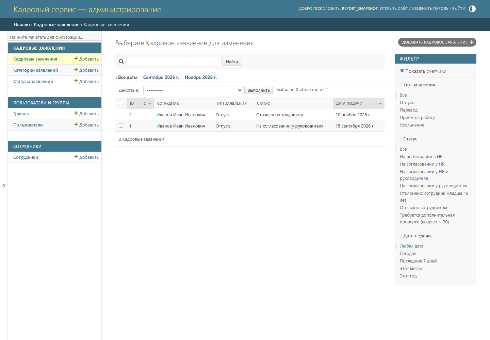
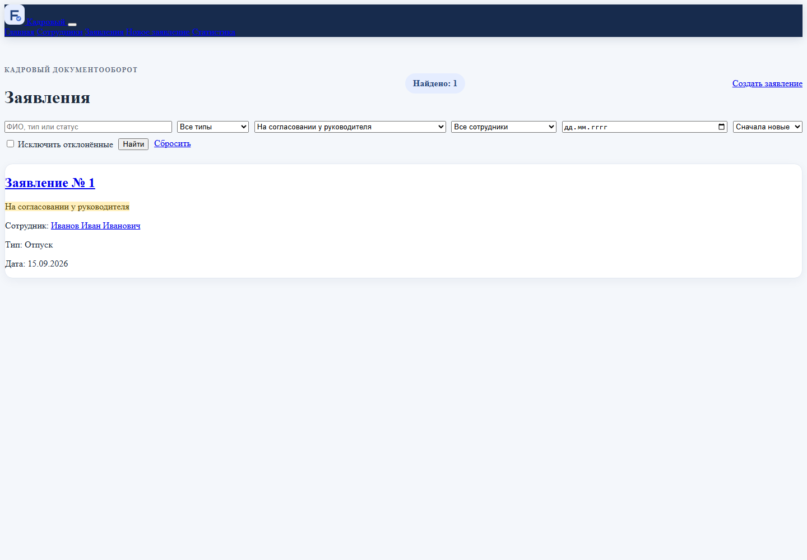
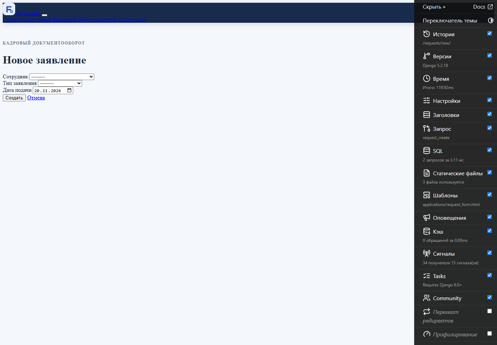

# Отчёт по практической работе № 10

## Административная панель Django и работа с данными через ORM

**Проект:** Application Track Service  
**Предметная область:** кадровые сотрудники и заявления  
**Дисциплина:** технологии разработки приложений на базе фреймворков

## Тема и цель

Работа посвящена настройке Django Admin и проверке ORM-запросов кадрового сервиса. Цель — дать администратору удобное русскоязычное управление сотрудниками и заявлениями и подтвердить, что поиск, фильтры, связанные данные и статистика работают на существующих моделях проекта.

## Задания учебного курса

На учебных материалах изучены регистрация моделей, настройка `ModelAdmin`, поиск и фильтрация в административных списках, получение связанных моделей, составные условия `Q` и просмотр SQL, который формирует ORM. Приёмы применены к моделям `Employee`, `Request`, `Category` и `Status`.

## Настройка административной панели

Модели сотрудников, заявлений, категорий и статусов зарегистрированы в Django Admin. Заголовок сайта и раздела управления заданы на русском языке. В приложениях установлены русские названия.

Для сотрудников список показывает ID, ФИО, подразделение и возраст; доступны поиск по ФИО и подразделению, фильтр по подразделению и сортировка. В карточку сотрудника включена встроенная таблица заявлений с типом, статусом и датой.

Для заявлений список показывает номер, сотрудника, категорию, статус и дату. Настроены фильтры по категории, статусу и дате, поиск по ФИО сотрудника и названиям связанных справочников, группировка по дате и выбор связанных объектов через `list_select_related`. Категории и статусы имеют собственные списки поиска.

Чтобы открыть панель на своём компьютере, создайте учётную запись администратора и запустите сервер:

```powershell
.\.venv\Scripts\python.exe manage.py createsuperuser
.\.venv\Scripts\python.exe manage.py runserver
```

Затем откройте `http://127.0.0.1:8000/admin/`.

## Проверка ORM и запросов

Поиск заявлений использует `Q` по ФИО, типу и статусу. Выборки по сотруднику, категории и статусу выполняются через связи модели. `select_related()` в списке и карточке заявления загружает связанные объекты одним ORM-запросом. `prefetch_related()` на странице сотрудника отдельно загружает набор заявлений и их справочники, избегая повторного запроса для каждой строки.

Списки используют `filter()`, `exclude()`, `order_by()` и `Paginator`. Статистика строится через `Count`, `Avg`, `F`, `annotate()` и `values()`. Добавлен `RequestQuerySet` с методами `active()`, `rejected()` и `withdrawn()` для повторно используемых выборок по состоянию.

Добавлен Django Debug Toolbar. Если зависимость установлена, middleware и маршрут `/__debug__/` подключаются в режиме разработки. Установка выполняется вместе с остальными пакетами из `requirements.txt`. Проверка локального ответа подтвердила HTTP 200 и наличие разметки панели на странице заявлений.

## Проверка результата

- `manage.py check` — ошибок конфигурации нет;
- `manage.py makemigrations --check --dry-run` — модель и миграции согласованы;
- проверены ORM-страницы списков, карточек и статистики;
- в приложении настроены четыре модели административного интерфейса;
- установлена и подключена панель анализа SQL-запросов.

Создание суперпользователя выполняется владельцем проекта локально: пароль для административной учётной записи в исходный код и отчёт не помещается.

## Вывод

Кадровые данные доступны через настроенную административную панель, а ORM-запросы используют связи моделей и подходящие средства оптимизации. Django Debug Toolbar позволяет во время локальной демонстрации открыть SQL-панель и объяснить запросы страниц.

## Скриншоты для итогового комплекта

Ниже приложены реальные снимки локального проекта. Для защиты также удобно открыть в терминале результаты `manage.py check` и `makemigrations --check --dry-run`.

Снимок Admin сделан на временной копии `db.sqlite3`: пользователь `REPORT_SNAPSHOT` и заявление № 2 созданы только в этой копии, чтобы показать список и работу отзыва. В рабочей базе эти записи не добавлялись.

### Списки Django Admin



### Фильтрация ORM-запроса



### Django Debug Toolbar


