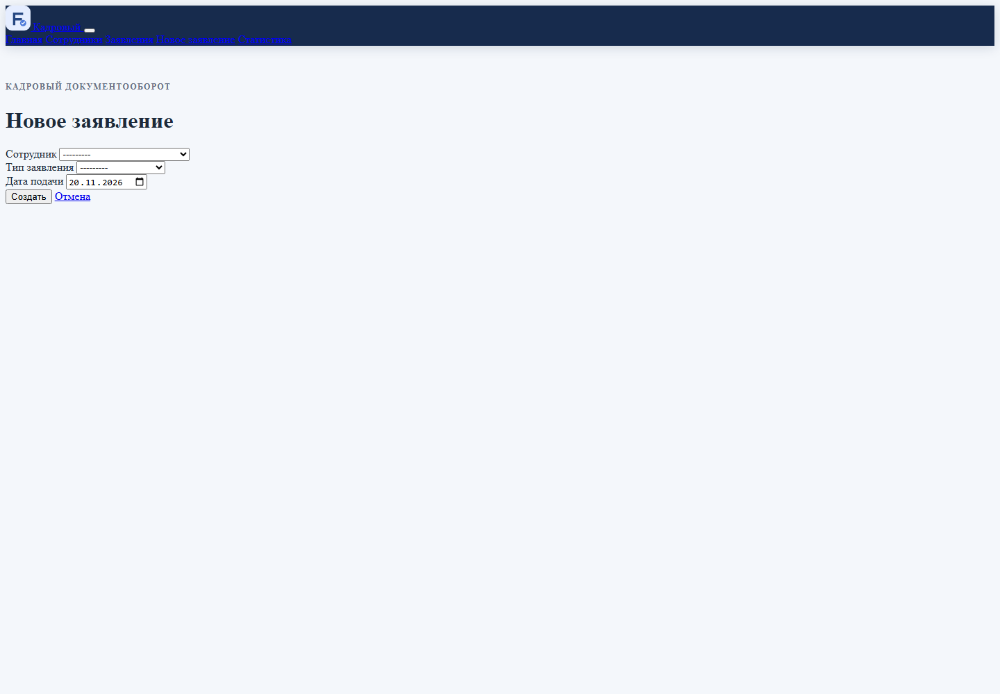
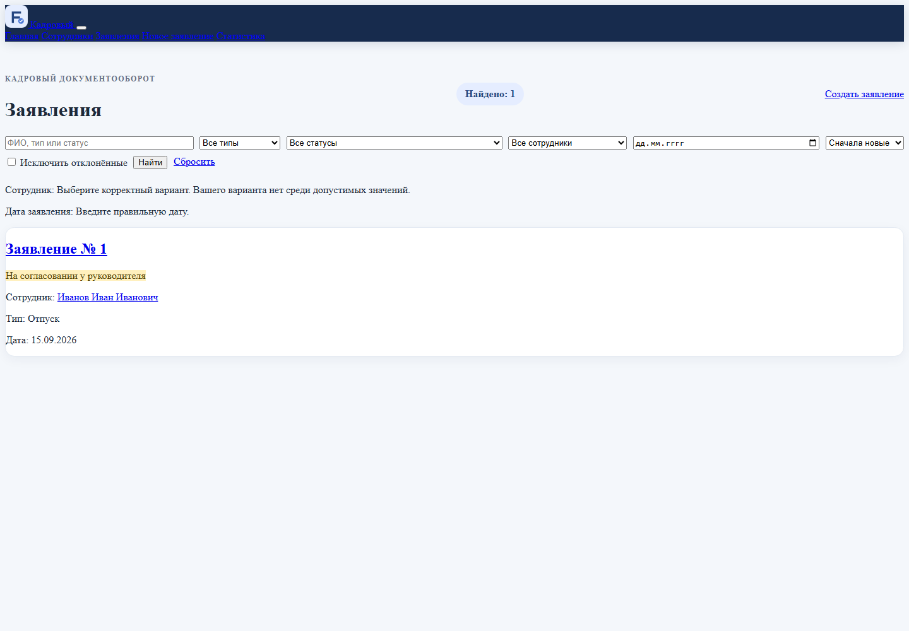
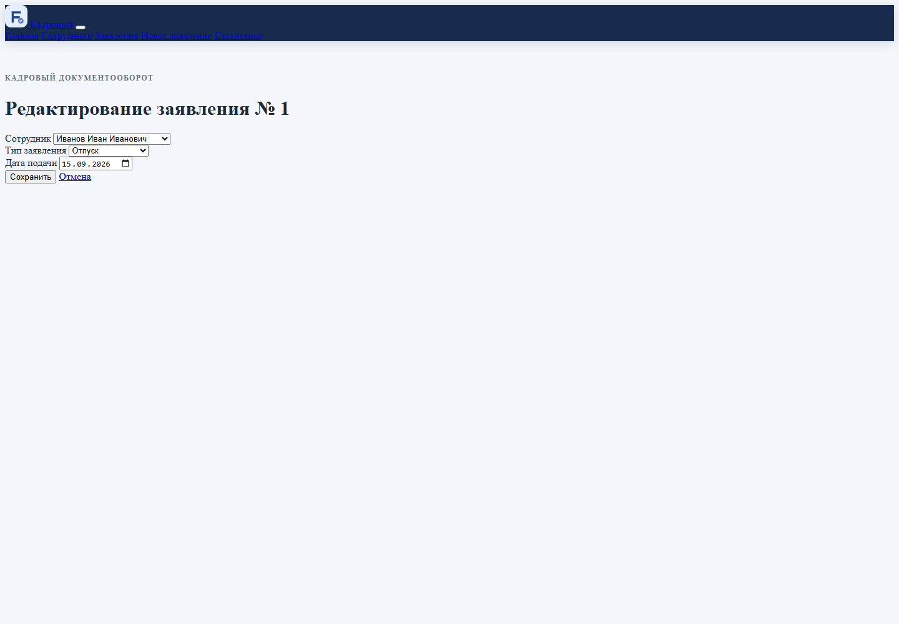
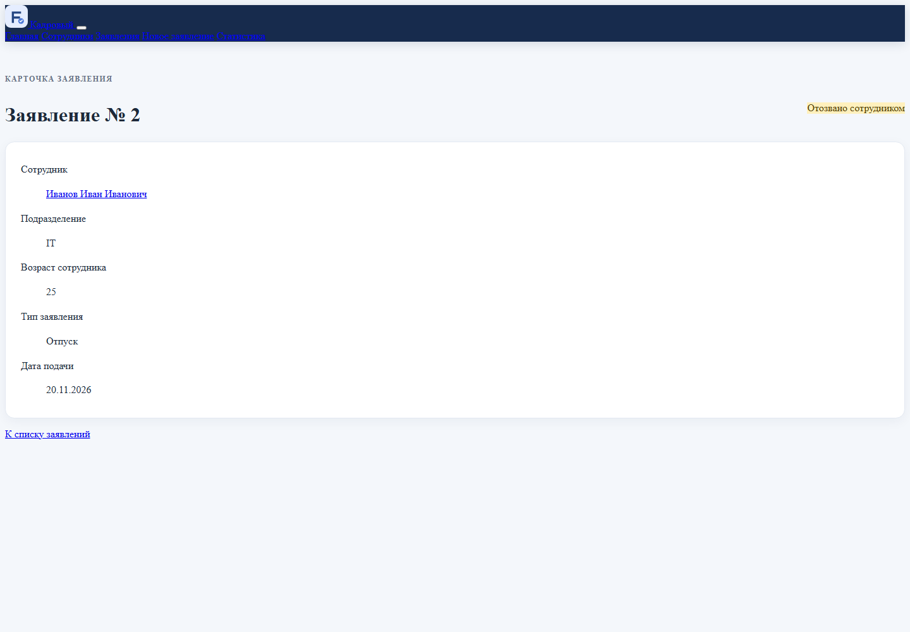

# Отчёт по практической работе № 11

## Формы в Django

**Проект:** Application Track Service  
**Предметная область:** кадровые сотрудники и заявления  
**Дисциплина:** технологии разработки приложений на базе фреймворков

## Тема и цель

Практическая работа посвящена обработке GET- и POST-запросов, созданию форм Django, проверке введённых данных и сохранению моделей через `ModelForm`. В Application Track Service формы применены для фильтрации, создания и редактирования кадровых заявлений.

## Задания учебного курса

Изучены `forms.Form` и `forms.ModelForm`, виджеты, подписи и CSS-классы полей, проверка через `is_valid()`, обработка `cleaned_data`, вывод ошибок и безопасная обработка POST с CSRF-токеном. Раздел загрузки изображений к кадровому проекту неприменим: в моделях сотрудников и заявлений нет поля изображения и такого требования предметной области.

## Созданные формы

В `applications/forms.py` создана `RequestFilterForm`. Она проверяет текст поиска, дату, сотрудника, категорию, статус и сортировку из GET-параметров. Для полей связей используются `ModelChoiceField`, для даты — `DateField`, для переключателя — `BooleanField`. Неверная дата или неизвестный ID показывают ошибку формы и не вызывают необработанного исключения.

Класс `RequestForm` основан на `ModelForm` и ограничен полями сотрудника, категории и даты. Статус исключён из пользовательского ввода: при создании он определяется сервером по действующему правилу предметной области. Для сотрудника младше 18 лет выбирается статус отказа, для сотрудника старше 70 лет — дополнительная проверка, для остальных статус зависит от типа заявления.

## Создание, редактирование и отзыв

Страница `/requests/new/` отображает пустую форму при GET и сохраняет проверенную запись при POST. После сохранения пользователь переходит к карточке заявления. Страница `/requests/<id>/edit/` передаёт существующую запись в `ModelForm`; изменение даты или типа не перезаписывает текущий статус обработки.

Отзыв заявления выполняется отдельной формой POST с ``. Запись не удаляется: миграция `applications/0002_add_withdrawn_status.py` добавляет статус «Отозвано сотрудником», а представление изменяет внешний ключ `status`. GET-запрос не выполняет отзыв. Для отсутствующей записи используется `get_object_or_404()`.

Форма фильтрации встроена в `/requests/`. Параметры остаются в URL, список фильтруется через ORM, а значения формы сохраняются при переходе между страницами.

## Проверка результата

Добавлено 8 Django-тестов, которые проверяют валидацию фильтра, обработку ошибок, создание заявления и автоматический статус для несовершеннолетнего сотрудника, редактирование с сохранением текущего статуса, отзыв только через POST с CSRF, выборки менеджера и регистрацию моделей в админке.

Результаты проверок:

- `manage.py test applications` — 8 тестов пройдены;
- `manage.py check` — системных ошибок нет;
- `manage.py makemigrations --check --dry-run` — несозданных миграций нет;
- `pytest -q` — 23 исходных теста пройдены;
- `flake8 . --extend-exclude=.venv` — замечаний нет.

## Вывод

Фильтры больше не доверяют непроверенным GET-значениям, создание и редактирование заявлений работают через `ModelForm`, ошибки показываются в шаблоне, а изменение статуса выполняется защищённым POST-запросом. Проект сохраняет существующие модели и ORM-архитектуру.

## Скриншоты для итогового комплекта

Ниже приложены снимки реальных страниц приложения, включая валидацию GET-параметров и отзыв заявления. Загрузка изображений не показывается, поскольку в кадровой предметной области она не используется.

Сценарий создания и отзыва на скриншоте выполнен на временной копии базы. Демонстрационное заявление № 2 не записано в рабочую базу проекта.

### Создание заявления

### Ошибки формы фильтрации

### Редактирование заявления

### Заявление после отзыва

