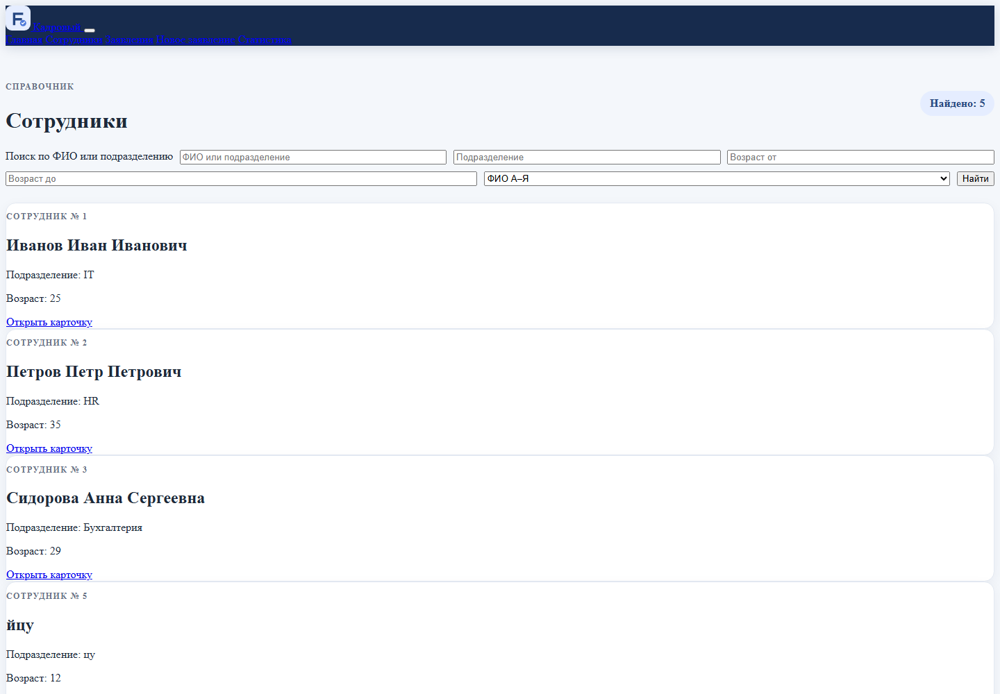
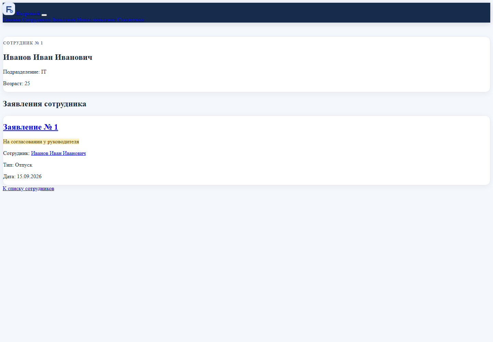
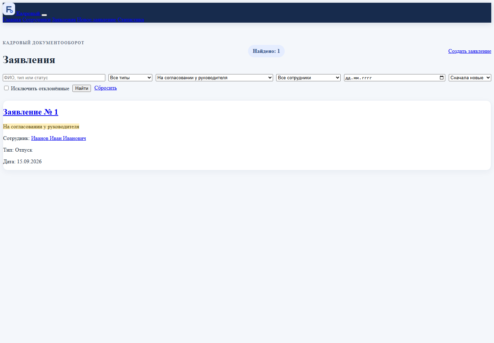
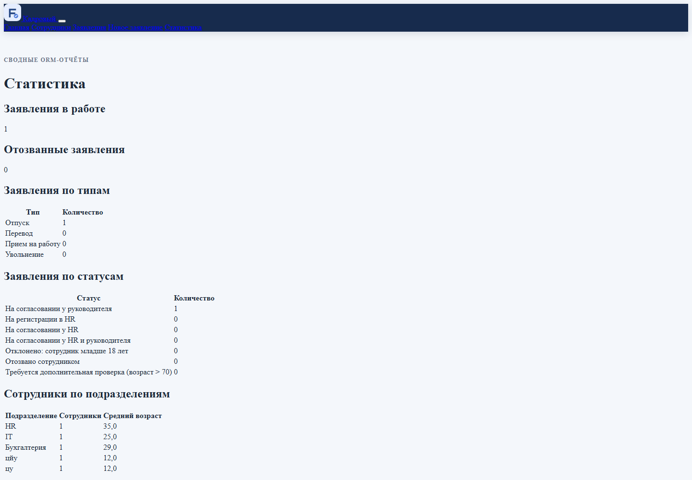

# Отчёт по практической работе № 9

## Модели Django и операции с базой данных через ORM

**Проект:** Application Track Service  
**Предметная область:** кадровые сотрудники и заявления  
**Дисциплина:** технологии разработки приложений на базе фреймворков

## Тема и цель

В работе слой доступа к данным веб-версии кадрового сервиса переведён с прямых SQL-запросов на Django ORM. Цель — описать сущности предметной области моделями Django, связать их внешними ключами, управлять схемой миграциями и выполнять чтение и изменение данных через ORM, сохранив существующие страницы приложения.

## Задания учебного курса

На учебном примере изучались модели Django, связи между моделями, создание и применение миграций, операции CRUD, фильтрация и сортировка наборов записей, а также загрузка данных в базу. Полученные приёмы перенесены на предметную область Application Track Service; модели комнат и бронирований из примера Roomly в проект не переносились.

## Модели и связи проекта

В `employees_web/models.py` создана модель `Employee` с полями ФИО, подразделение и возраст. Для возраста заданы проверка диапазона от 1 до 120 и ограничение на уровне базы данных.

В `applications/models.py` описаны модели `Category`, `Status` и `Request`. Заявление связано с сотрудником, категорией и статусом через `ForeignKey`. Для связей задано `on_delete=PROTECT`, поэтому справочник или сотрудника нельзя удалить, пока на них ссылаются заявления. Обратная связь `employee.requests` даёт заявления сотрудника.

## Миграции и перенос данных

Миграции `employees_web/0001_initial.py` и `applications/0001_initial.py` описывают структуру целевой базы Django `db.sqlite3`. Команда `import_pr7_data` переносит записи из базы ПР7 `data/application_track.sqlite`, сохраняет идентификаторы и связи и допускает повторный запуск. Исходная база ПР7 остаётся отдельным источником, а веб-представления читают целевую ORM-базу.

Команды подготовки и запуска:

```powershell
.\.venv\Scripts\python.exe manage.py migrate
.\.venv\Scripts\python.exe manage.py import_pr7_data
.\.venv\Scripts\python.exe manage.py runserver
```

## Использование Django ORM

Представление списка сотрудников использует `filter()` с `Q` для поиска по ФИО или подразделению, фильтрует по возрасту и подразделению, применяет `order_by()`, `annotate(Count(...))` и `Paginator`.

Список заявлений применяет фильтры по связанным моделям, `exclude()` для отклонённых записей, сортировку, `select_related()` для сотрудника, категории и статуса и постраничный вывод. В карточке заявления связанные сведения загружаются вместе с основной записью. Карточка сотрудника применяет `prefetch_related()` для списка заявлений и справочников статуса и категории.

Страница статистики использует `Count`, `Avg`, `F`, `annotate()` и `values()` для подсчёта заявлений по типам, статусам и подразделениям. Отсутствующие записи обрабатываются через `get_object_or_404()`.

## Проверка результата

Проверено:

- `manage.py check` — системных ошибок нет;
- `manage.py makemigrations --check --dry-run` — несозданных миграций нет;
- `manage.py showmigrations` — начальные миграции ORM-приложений применены;
- команда переноса сохраняет связи и первичные ключи;
- страницы сотрудников, заявлений и статистики работают через ORM;
- 23 исходных теста проекта проходят.

На момент подготовки отчёта в базе было 5 сотрудников, 4 категории, 6 исходных статусов и 1 заявление. В рамках ПР11 справочник статусов расширен статусом отзыва, поэтому в текущей базе отображается 7 статусов.

## Вывод

Веб-часть проекта использует Django ORM вместо ручного SQL-доступа. Сущности связаны моделями, схема управляется миграциями, исходные записи импортируются отдельной командой, а поиск, сортировка, статистика и связанные объекты отображаются на страницах кадрового сервиса.

## Скриншоты для итогового комплекта

Ниже приложены снимки работающей веб-версии. Перед сдачей дополнительно можно приложить фрагменты ORM-моделей и вывод `showmigrations` из IDE и терминала.

### Список сотрудников



### Карточка сотрудника и связанные заявления



### Список кадровых заявлений



### ORM-статистика


